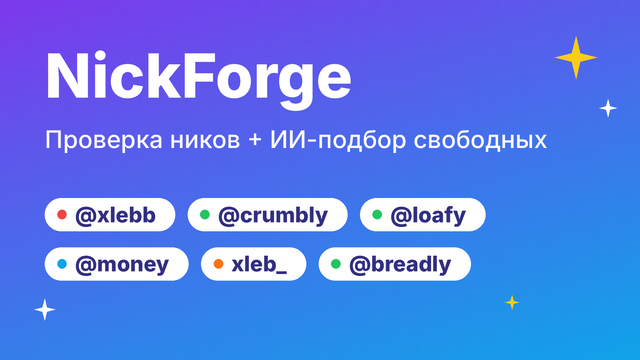

# Всё для @BotFather

Готовые тексты и картинки для бота **NickForge**. Те же тексты лежат в коде —
`nickbot/profile.py`, и скрипт `setup_profile.py` может проставить большую часть сам.

| Поле в BotFather | Команда | Что вставить |
|---|---|---|
| Имя | `/newbot`, `/setname` | `NickForge · Проверка ников` |
| Username | `/newbot` | `NickForgeBot` (запасные — ниже) |
| Аватарка | `/setuserpic` | [`avatar.png`](avatar.png) |
| Описание (What can this bot do?) | `/setdescription` | текст ниже |
| Картинка описания | `/mybots` → бот → Edit Bot → Edit Description Picture | [`description.png`](description.png) |
| About (короткое описание) | `/setabouttext` | текст ниже |
| Команды | `/setcommands` | список ниже |
| Inline-режим | `/setinline` | `ник для проверки…` |

<p>
  
  &nbsp;
  
</p>

---

## 1. Создать бота

1. Открой [@BotFather](https://t.me/BotFather) → `/newbot`.
2. Имя: `NickForge · Проверка ников`
3. Username (должен заканчиваться на `bot`): `NickForgeBot`.
   Если занят — по очереди: `NickForgeRuBot`, `NickCheckRuBot`, `FreeNickCheckBot`,
   `NikCheckBot`, `UsernameCheckRuBot`, `SvobodenLiNikBot`, `TgNickCheckBot`.
   Если поменял — поправь `BOT_USERNAME` и тексты в `nickbot/profile.py`.
4. BotFather пришлёт **токен** — вставь его в `nickbot/.env`:
   ```
   BOT_TOKEN=1234567890:AAAA...
   ```

## 2. Заполнить профиль автоматически (рекомендую)

```bash
cd nickbot
python botfather/setup_profile.py
```

Скрипт через Bot API поставит имя, описание и About (ru + en), меню команд и аватарку.
Останется вручную только **inline-режим** и **картинка описания** (шаги 4 и 3.5 ниже).

## 3. …или заполнить вручную

### 3.1 `/setuserpic` — аватарка
Отправь файл [`avatar.png`](avatar.png) (640×640) **как фото**.

### 3.2 `/setdescription` — «What can this bot do?»
Показывается в пустом чате перед кнопкой «Старт» (до 512 символов):

```
🔎 NickForge — проверка ников в Telegram.

Отправь ник (например @xlebb) — я скажу:
🟢 свободен · 🔴 занят · 💎 продаётся на Fragment · ❌ не по формату и почему.
Можно проверить сразу несколько.

🤖 ИИ-подбор (/ai): опиши, какой ник хочешь, — ИИ придумает нешаблонные варианты, сам проверит их и покажет только свободные.

Работаю в любом чате: @NickForgeBot ник

Жми «Старт» 👇
```

### 3.3 `/setabouttext` — About
Видно в профиле бота (до 120 символов):

```
Проверю, свободен ли ник в Telegram, и объясню, если он не по формату. А ИИ найдёт свободный и нешаблонный 🤖
```

### 3.4 `/setcommands` — меню команд
Отправь одним сообщением:

```
start - Начать и узнать, что я умею
check - Проверить ники: /check xlebb durov
ai - ИИ-подбор свободного ника (вкл/выкл)
help - Статусы, правила username и помощь
```

### 3.5 Картинка описания
`/mybots` → выбери бота → **Edit Bot** → **Edit Description Picture** →
отправь [`description.png`](description.png) (640×360).

## 4. `/setinline` — проверка в любом чате

`/setinline` → выбери бота → плейсхолдер:

```
ник для проверки…
```

После этого в любом чате можно набрать `@NickForgeBot xlebb` и сразу увидеть статус.

## 5. Остальные настройки (по желанию)

| Команда | Значение | Зачем |
|---|---|---|
| `/setjoingroups` | Enable | можно добавить в группу и проверять командой `/check@NickForgeBot ник` |
| `/setprivacy` | Enable (по умолчанию) | в группах бот видит только команды, а не всю переписку |
| `/setinlinefeedback` | Disabled | статистика inline-выбора боту не нужна |

> Картинки перерисовываются командой `python botfather/generate_assets.py`.
